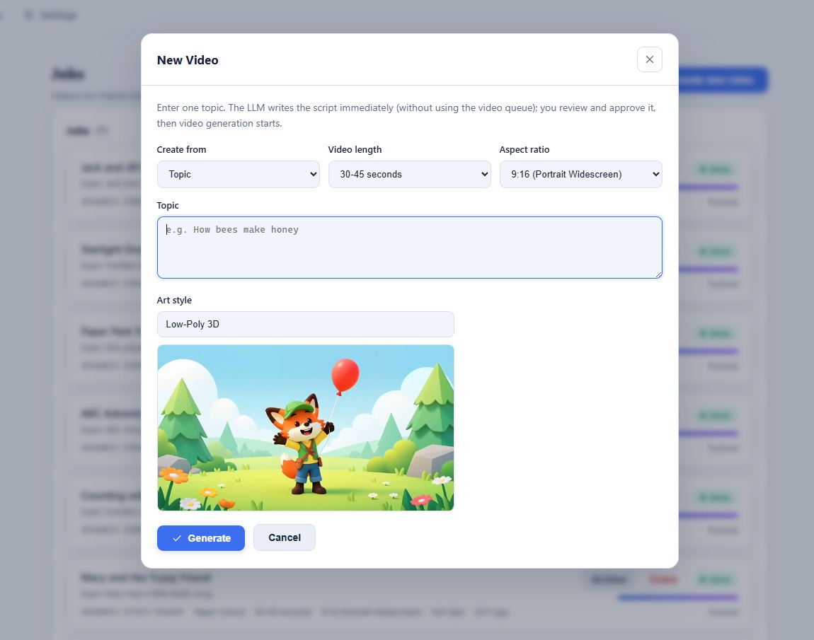
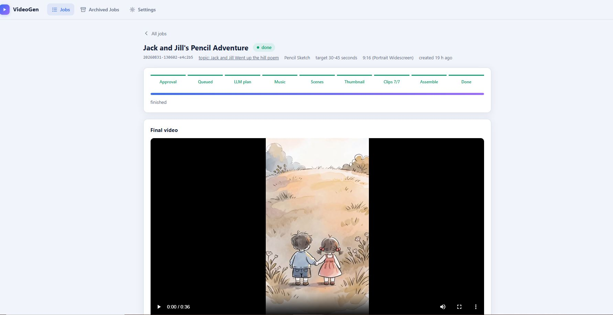
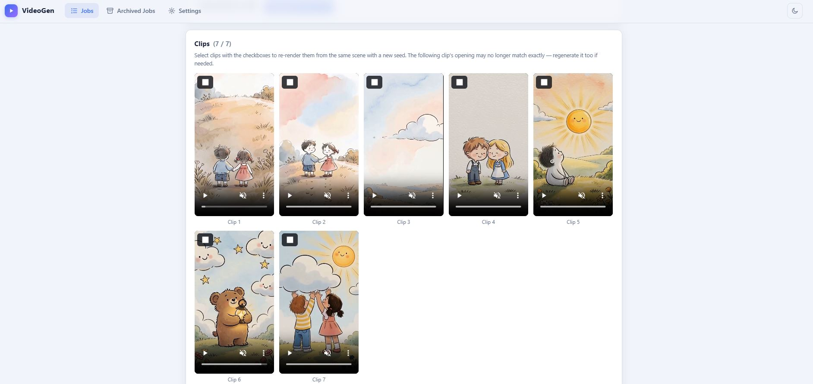

# VideoGen — AI Video Generator for Your YouTube Channel

VideoGen turns a YouTube video, a topic, your own script or a GitHub / Hugging Face page into a brand-new AI video tailored to one of your channels — animated, realistic or tech-explainer, with content rules matching the channel's audience — complete with an original soundtrack **or a voiceover narration in a voice you choose (Fish Speech voice cloning)**, scene-synced visuals, a YouTube-ready thumbnail, and SEO metadata — then publishes it to YouTube with one click, using locally hosted AI services end to end.

Pick a channel, give it a URL, a topic or your own script, choose an art style and aspect ratio, and the pipeline produces a finished `final.mp4` plus everything needed to publish it. Finished videos can then be **joined into one long compilation** — chapters, title and thumbnail included — which is where a channel's watch time actually comes from.

## Features

- **Four ways to create a video** — a YouTube URL (transcript-driven), a **topic** (the LLM invents the script), your own **description / short script** (the LLM builds on it faithfully), or a pasted **transcript / script** (used as the script as-is; the LLM only fixes typos, cue tags and the like). Kids-channel song videos can additionally take your own **song lyrics**, sung verbatim. Topic/description/transcript jobs draft their script immediately — outside the video queue — and wait for your **approval** before any video generation starts.
- **Bring your own music** — on a song video, upload a track (10 seconds to 6 minutes) instead of having one generated. It is used as the soundtrack exactly as you recorded it, no song is written or rendered, and **the video comes out the same length as your music**: the track's measured duration decides how many clips are made. Any vocals are transcribed once so the scenes follow what is sung; a purely instrumental track gets scenes that follow the script instead. Available on any channel.
- **30 selectable art styles** — Anime, Western Cartoon, Pixar-like 3D, Claymation, Watercolor, and more; each drives the visual direction of every generated shot and the thumbnail. A **preview image** of each style (rendered once by your own video model via Settings → "Generate style previews") is shown while picking.
- **Multiple channels** — manage any number of channels in Settings, each with its own name, purpose, logo, audience (Kids / Family / General), video type (Animated / Real / Tech) and per-video defaults. Every video is generated to match the channel picked in the New Video dialog, and uploads go to that channel's own connected YouTube account. Real and Tech channels skip the art-style picker and use a built-in realistic live-action look; **Tech** channels additionally get concrete, technically accurate scripts (devices, screens, code, data-centre visuals) and the on-screen story board switched on by default.
- **On-screen story board** — an optional overlay (per video, default on for Tech channels) of styled fact cards: the LLM plans a kicker (KEY FACT, HOW IT WORKS, BY THE NUMBERS…), a headline and a one-line body for the right moments of the narration, some with a **related still image** rendered by the video model in a shape matching the video (square for portrait, 4:3 for square, 16:9 for landscape); the cards are drawn with Pillow and composited over the clips with fades, timed to the actual clip cuts. A card never shares the screen with the hook or the end card, and on a repository video it yields a few tenths of a second to the page panel rather than crowding it out. Toggle or regenerate it on any finished job, then reassemble.
- **Eight card layouts, several in every video** — a video no longer shows the same rectangle six times. Each card's own content picks a layout *family* — a card carrying a figure becomes a **big stat** (the number pulled out as the hero) or a compact **accent chip**; a card with a rendered still becomes a **split** or an overlapping **photo stack**; the opening and closing cards become a centred **full-bleed banner** or a **quote slab**; everything else is the classic **lower third** or an edge-to-edge **ribbon**. A seed taken from the job id picks the variant inside the family, so the mix never repeats a layout back to back and the same job always renders identically — a reassemble, an upscale or a regenerated clip can never restyle a finished video, because each card's layout is frozen into `plan.json` the first time it is planned. Cards also **ease into place** instead of only fading in, which costs nothing: the movement is a per-frame position in the overlay pass that already runs, so it is still one encode. Settings offers the full mix, a panels-only set, or classic-only.
- **Burned-in captions** — word-synced subtitles over the video, with the word being spoken picked out in colour. Controlled at three levels: a **master switch** in Settings (off means no video is captioned, whatever anything else asks for, and reassembling an existing video strips them), a per-channel default, and a per-video switch in the New Video dialog. Default on for Tech channels. The words come from the **script itself**, not from a transcription of it: the narration is timed with whisper and then snapped back onto the written text, so a mis-heard word is corrected before it is ever drawn. Story videos need no transcription at all — every line is spoken on its own and laid on the clip grid, so its timings are exact by construction — and song videos reuse the timings already made for the lyric-synced scenes. The track is an `.ass` subtitle file burned by libass **in the same encode as the overlays**, so captions cost no extra pass, and it carries the frame size so it scales itself to whatever resolution the video was upscaled to. A caption never sits on a story board card: for as long as one is up, the caption moves above it.
- **A presenter who speaks the voiceover** — the narration no longer has to come from nowhere. Give a channel a roster of portraits on the Settings page, pick which one speaks a video, and that face is animated to **lip-sync the narration** and composited over the clips: either a **cut-out** with no background, anchored to the bottom edge so the torso runs off frame (a floating head with a cut neck is the thing that looks wrong), or a **circle bubble** in a corner with a ring and a drop shadow. It appears over the intro and the outro by default — the middle belongs to the story board — and the windows are snapped to the gaps between spoken words, reusing the caption timings the pipeline already has, so a segment never starts or stops mid-syllable. **Whole video** lays the segments end to end instead: on an engine that renders a fixed chunk (Wan: 4.81 s) that is a contiguous chain of them, one render per chunk and a pose reset at each seam, so the presenter never leaves — and it falls back to the two bookends when the budgets cannot pay for the whole length, which is what they are there to decide. Two engines, chosen per video: **Wan 2.2 S2V** holds the likeness (the face in the video is recognisably the person you uploaded) and is the default, while **LTX 2.5** is 33x faster and already the stack the clips render on, so it is what a tight budget falls back to — it lip-syncs about as well but renders a younger, thinner stranger. Neither was picked by eye: both were correlated against the speech envelope, with a time-reversed envelope as the control. Because the good engine costs ~9 s of GPU per output frame, **two budgets** guard it — how much presenter a viewer should see (`AVATAR_MAX_SECONDS`) and how much of the shared GPU one video may spend getting it (`AVATAR_MAX_RENDER_MINUTES`) — and coverage is trimmed to fit with the reason logged, never silently. Both budgets, the look, the size and the corner are on the **Settings page**; size and position are read at assembly time, so changing them and reassembling applies to a finished video without re-rendering a frame. Cutting the background away runs on your **CPU**, not the GPU box, because matting is cheap (~0.7 s a frame) and the render box is a shared, serial resource better spent on the render. The portrait is prepared **once, when you upload it** — flattened opaque and cropped square anchored on the head rather than the image centre, so no per-video time goes into it and a tall headshot never loses the top of its head. Placement is computed from fractions of the frame, so one setting covers 1080p through 4K and 16:9, 9:16 and 1:1 alike, and the overlay is drawn in the **same single encode** as the cards and captions. A missing portrait, a missing model or a blown budget costs the overlay and nothing else — the video is still finished.
- **Two thumbnails when there is a presenter** — a video with a talking-head avatar also gets its thumbnail **with the presenter in it**: one frame of the segment, cut out with the matte already made for the overlay, composited into the same corner at the same fraction of the frame the video uses, so the thumbnail promises the picture the video delivers. Both versions are offered on the job page — with the face and without, each with its text treatments and a text-free option — because which one earns the click is a judgement call and neither costs a GPU render. Automatic whenever the video has a presenter; a failure costs only that extra choice.
- **A thumbnail that carries text** — the generated picture still contains no letters (image models spell badly, and the prompt forbids typography), so a punchy 3-5 word line is drawn over it afterwards with Pillow, in three different treatments. One GPU render, three candidates: pick one on the job page and it becomes the thumbnail the download, the publish bundle and the YouTube upload all use. "No text" stays a choice. Controlled the same three ways as the captions — a master switch in Settings, a per-channel default and a per-video switch — except that it defaults **on for every channel**, not just Tech ones: it is drawn on the thumbnail image rather than over the video. Works retroactively — a video made before this existed adopts its own finished thumbnail as the base. On a **kids** channel the line is cut to **2-3 words under 18 characters** instead of 5 under 24, and the picture is composed for a toddler audience being scrolled past on a phone: one character's face filling most of the frame, at most one other object, a flat high-contrast background, no scenery and nothing in the distance. Five small words and a busy background read as noise at thumbnail size, which is the likeliest reason a channel sits at 2.7% click-through against the 4-7% kids content should reach. The length the model is asked for and the length the drawing enforces come from one place, so they cannot drift apart.
- **Real tags, the right category and chapters** — the SEO step always generated search keywords and then threw them away, so every upload went out with **no tags at all**; they are now packed under YouTube's 500-character cap and sent. Uploads were also hard-coded to category 24 (Entertainment), which buries a technical video: a Tech channel is now filed under 28 (Science & Technology). And the description gains a **chapter list** built from the real clip cut points, obeying YouTube's rules exactly (first at 0:00, at least three, each at least ten seconds) — a video too short for a valid list simply gets none, because YouTube ignores a partial one.
- **Hook card, end card and progress bar** — the opening line is already the first thing spoken; it is now also shown full-screen over the first seconds, which is the whole video for a viewer who has not pressed unmute. A subscribe card closes the video, kept clear of the lower-right quarter where YouTube draws its own end-screen elements, and a thin accent progress bar fills across the bottom. A short whoosh marks each card appearing — synthesized with ffmpeg on first use and cached, so no audio file ships with the app — and it is deliberately **not** ducked under the voice, since a whoosh you cannot hear while the narrator talks is pointless. The final mix is also loudness-normalised to about -14 LUFS, which is what YouTube normalises to anyway: an un-normalised master is simply played quiet.
- **Clean voiceover mix** — voiceover videos mix narration + an instrumental bed only: the clips' own generated sound effects are dropped by default (they clashed with the voice and the music and jumped at every cut; `CLIP_AUDIO_WITH_MUSIC` brings them back). The music bed is **side-chain ducked** under the voice, looped with a cross-fade when the model ends the track early, faded out at the end, and the mix is trimmed to the video and soft-limited. When ambience is kept it is dipped to silence around every clip cut.
- **Audience-aware safety** — the channel's audience preset drives the LLM content rules: kids channels stay strictly gentle and family-friendly (even "dark" styles render playful and reassuring), family channels allow mild peril, general channels follow platform guidelines only.
- **Channel branding** — each channel's name replaces any channel/brand names found in source content, across narration, lyrics, and SEO; its purpose text steers the tone of every script.
- **Character videos on or off** — a per-channel switch on the Settings page. On, the channel's recurring cast drives every script, scene, thumbnail and weekly plan. Off, the channel makes **informative explainers** instead: hook, the viewer's problem, the concrete steps, the payoff, spoken straight to the viewer as *"you"* — no protagonist, no story, no invented persona. Generic unnamed people (a project manager at a laptop, hands typing, a presenter) can still appear on screen, they are just never named or recurring. It is independent of the audience preset, so a grown-up channel can have characters and a kids channel could go character-free. Switching it off keeps the cast and its portraits, so it is reversible.
- **Videos from a GitHub repo or a Hugging Face model** — on a Tech channel, paste a `github.com` repository or a `huggingface.co` model, dataset or space URL instead of a YouTube link. The README or model card and the project's real facts (stars, downloads, licence, task, library) become the script, which you review and approve before anything renders. Optionally the live page is screenshotted with a locally installed headless Chrome and scrolled slowly as a large panel over the middle of the video, so viewers see the actual repo. The panel keeps its window even when the story board cards fill the middle — the cards are shortened to clear it, which costs about 0.3 s of one card — while the hook and end cards are never covered. No extra Python packages; if no browser is found the video is still made from the README.
- **The video keeps its promises** — when a script offers the viewer something ("the exact prompt structure is in the description", "grab the checklist"), that thing is written and saved with the video as `resource.md`, `resource.txt` and a branded `resource.pdf` carrying the channel logo, and appended to the generated YouTube description so it is ready to publish. The decision comes from the finished script alone and the promise has to be quoted out of it word for word, so a video that promises nothing gets nothing. The script writer is never told to make such an offer.
- **Every repo video ships a setup guide** — a video made from a GitHub repo or a Hugging Face page always hands the viewer the hands-on guide for that project, whether or not the script promised anything, because the README it was written from already holds the install and quickstart material. Requirements, install commands, first run, the flags worth knowing and a short troubleshooting list, written from that README only — never from what the model remembers about the project — and saved as the same three files, with the channel logo and name on the PDF and the channel name over the text versions. It is a download, not a description append: nobody was told to look in the description for it, so the SEO description is left exactly as written. A script that *did* promise something still wins, so a video never ships two documents.
- **Recurring cast** — give a channel up to 24 named characters (an elephant, a kid, …) with a precise look and personality, or **import a Character Bible** (a markdown document with a `### Name` block per character plus style, rules and checklist sections) in one paste on the Settings page: the character blocks become cast entries, the other sections become the channel's **Style & rules** text that is sent as a fixed reference with every script and scene prompt. Not every character is in every video: the LLM picks the 1-3 the story needs (or exactly the ones you name in the topic, e.g. *"Use Ava as the main character and Leo as the supporting character"*); the full roster is only sent while the script is written, afterwards every prompt carries just this video's characters, and each character's canonical look is prepended to every scene, thumbnail and story board prompt that names them, so the video model gets the same description every time. Approve a **reference portrait** per character (rendered by your video model in the channel's art style, or uploaded): the first character of the story that has one becomes the first frame of clip 1, so the video opens on the real character and the following clips chain from it. Looks and colours stay consistent; faces can still drift later in long videos, since the model has no identity-lock beyond the first frame.
- **Rank the cast by what actually performs** — a channel's characters are never equally popular: on this one the top character earned 50 hours of watch time and the weakest earned six minutes, yet every one of them was equally likely to be cast. Each character now carries a **priority** on the Settings page — *Lead* (carries the channel), *Normal*, or *Resting* (don't cast) — separate from its *role*, because a flagship character and a dud can both be "main". Leads are listed first in the roster the script writer sees and are the ones it is told to cast; a resting character is left out unless you name it yourself in the topic, which still works. The weekly planner spends most of the week on the leads, and whatever reaches for "the first character" — the portrait that opens a video, the faces in a thumbnail — reaches for a lead. It is set by hand, deliberately: the app's YouTube permission is upload-only and cannot read your analytics, so you paste in what you see in Studio. A resting character keeps its portrait, its voice and its canonical look, so nothing you already made changes and the decision is reversible; a channel that never touches the field keeps exactly the prompts it had. A character bible may also carry a `Priority:` line.
- **Job dashboard** — the jobs list shows every job's parameters at a glance (channel, audio choice and voice, art style, target length, aspect ratio, clip progress), with a per-channel filter, text search and pagination; the archive page gets the same filter, search and pagination.
- **Song or voiceover, chosen per video** — the New Video dialog offers **Generate Song** (an original song is generated **first**; its actual length sets the clip count and its lyrics drive the visuals) or **Generate Voiceover** (the LLM writes the narration, Fish Speech speaks it, and a gentle **instrumental** music bed — never sung lyrics — is mixed underneath at low volume). The channel's default audio preselects the dialog; a pure `narration` mode (no music bed) remains available via the API.
- **Voice cloning with reference voices** — upload short speech samples (plus the exact text spoken in them) on the Settings page, then pick a voice per voiceover video; Fish Speech clones it for the narration. No selection = the model's default voice, **kept the same for the whole video** (the first narration chunk becomes the reference for the rest, so long narrations no longer switch speakers between chunks); a *random voice per segment* option keeps the old behaviour.
- **Sing your own lyrics (kids channels)** — the New Video dialog shows an optional **Song lyrics** box when a kids channel is set to *Generate Song*. Paste a sheet and those exact words are sung: the LLM only writes the music caption and adds `[Verse]`/`[Chorus]` tags, and a deterministic check puts your words back if it edited any. Your lyrics also **set the length** — *Video length* greys out, the target is your sung-word count at the kids singing pace, and the “too short” rewrite never runs. Up to 250 sung words.
- **Compilations — one long video out of the finished ones** — pick 2 to 12 finished videos of a channel on the Jobs page and they become a single long upload, in the order you tick them. This exists because of what a channel's own numbers say: a short video has to find its own audience and most never do, while one ten-minute compilation on this channel produced **a quarter of its entire watch time**, and watch time is what the recommendation surfaces actually run on. Nothing is rendered — the videos are joined exactly as they were finished, so a twenty-minute compilation is **a minute of local ffmpeg**, never queued behind a render and never waiting for the GPU window. It gets a **chapter list with one chapter per video**, at the real cut it starts on and titled with that video's own title; a **title that opens with the length** ("18 Minutes of Tilly the Train | Toddler Songs & Stories" — rounded *down*, because a title promising more than it delivers is the one inaccuracy a viewer punishes immediately) and a description written for the compilation; and a **thumbnail lifted from one of its parts**, with the usual three text treatments drawn over it, so the whole job costs no GPU render at all. It is an ordinary job from there on: upload it to YouTube with one click, download the bundle, upscale it, archive it. The parts stay published in their own right and a compilation keeps playing even if one of them is later deleted. Videos of different sizes are fitted and padded to the largest frame among them rather than cropped (a part may already be published, so losing its edges is worse than a black border); mixing portrait and landscape in one compilation is refused rather than decided badly. A week of planned videos also offers **"Make a compilation from this week"** once its videos are done, which opens the picker with exactly those videos already ticked.
- **Weekly planner** — the Planner page writes a week of video ideas for one channel in a single LLM call: **2 to 7** dated rows, spaced out across the week rather than stacked on its first days, because every upload competes with the channel's others for the same audience — a few strong videos plus a compilation beats a daily trickle. Asking for fewer also changes what is written, not just how much: the brief tells the LLM these are the week's *best* ideas, each worth a full watch, rather than handing back the same seven minus four. Seven stays the default, and a plan made before this existed still reads as the seven-day week it was. Each row carries the cast it needs, a title, a 2-4 sentence story from beginning to end, a thumbnail idea and the spoken opening line. Earlier titles from that channel are sent along so a new week never repeats one. Rewrite any day you do not like (with optional feedback), then confirm the rows you want — each becomes a **paused** job that runs nothing until you open it and press Start. On a kids channel with a cast you can pick **Video type → Story based** for the whole week, and every video confirmed from it arrives already set up as a story, so a week of stories is one choice rather than seven. The plan remembers that choice, and the week is written knowing it — a story is rendered as clips that each continue from the previous one, so its ideas stay in one or two connected places instead of hopping across the world.
- **Story videos (kids channels)** — a per-video **Video type** choice next to the audio options: *Song based* (everything above) or *Story based*. A story video is the other way round from a song: the LLM first invents the **scenes** that build the story — one beat per clip, each a single visible action in a place the previous beat can walk into — and only then writes the **voiceover from those beats**. That order is the whole feature. The spoken lines are nothing but what happens and what the characters say (*“Ellie waited for the train to arrive.”*, *“All aboard!”*), never a description of the picture: the writer is never even shown the character looks, a worked wrong/right example is in the prompt, and a deterministic check catches any line that still names a colour, a garment, a species or the camera and has just that line written again. **Every character speaks in its own voice** — give each cast member a reference voice on the Settings page, or set one **default character voice** for the channel (a child sample makes the whole channel sound like kids); a character with neither gets a voice invented once and kept for the whole video. Each line is spoken on its own and laid out on the clip grid, so the picture and the words are in sync **by construction** — no transcription, no alignment. A clip is the usual length, or longer when its line needs the room, and **you review and edit every scene and line before anything renders**.
- **Lyric-accurate visuals** — the generated song is transcribed with word timestamps (faster-whisper); each clip's scene is written from the words *actually sung during that clip's window*, so what you hear is what you see. Instrumental passages get atmosphere/transition scenes.
- **Two video models, chosen per video** — clips render on either **MiniMax H3** or **LTX 2.5**. Pick the default on the Settings page and override it per video in the New Video dialog (or a planned job's setup card); the jobs list, the archive and the job page all badge which model a video used. The two round clip length differently — a requested 5 s comes out as 5.17 s on H3 and 5.04 s on LTX — and that real length is what the lyric windows, the story line timing and the clip count are built from, so the choice is **frozen when the video is planned**: it cannot be switched under a job whose audio is already laid out. LTX 2.5 also takes a **negative prompt**, which defaults by channel type (naming cartoon and video-game looks helps a Real/Tech channel and fights an animated one) and is editable in Settings. Thumbnails, cast portraits and story board stills always render on MiniMax H3 whatever a video picked — they are 5-frame renders, a length only that graph can express. Adding a third model is one entry in `config.VIDEO_MODELS` plus its workflow JSON: no node id lives anywhere else.
- **Continuous clips** — clip 1 is text-to-video; every following clip is seeded with the last frame of the previous one for smooth visual flow. Both models ship a text-to-video and a first-frame graph, so the chaining works the same either way.
- **Thumbnail generation** — an LLM-designed scene that instantly shows what the video is about, rendered through the video model as a JPG matching the video aspect ratio (1280×720 for 16:9, 720×1280 for portrait, etc.), with the **channel's logo** overlaid top-right. One-click regeneration on any finished job.
- **SEO metadata** — a keyword-optimized YouTube title and description (with hashtags and a subscribe call-to-action) generated for every video. On a **kids** channel the title rule is different, because a toddler-content title is not read but scanned — by a parent typing two or three words into the search box, and by a sidebar that truncates around 60 characters on a phone: the words that get the video found have to come **first**. The title is capped at 60 characters with the character's name and the plain subject ("Train", "Clean Up Song", "Learn Colors", "ABCs") inside the first 40, and it may never open with the channel name, a number or a clause before the subject. The weekly planner writes its titles in that same shape, so the SEO pass sharpens them instead of fixing them. Every other audience keeps the original rule.
- **LLM review pass** — every generated scene and every drafted script is reviewed a second time by the LLM against the exact audio/content it must match, and inconsistencies (a wrong letter, a mismatched object, an unsafe detail) are fixed automatically. The reviewer is transcription-aware: if the speech recognizer misheard a letter, it trusts the word ("fairy" belongs to F). Toggleable via `SCRIPT_REVIEW`.
- **Per-job target length** — pick Auto, 30-45 s, 45-60 s, 1-2 min, 2-3 min, 3-4 min or 4-5 min when creating a job; a soft target that guides the script length and the generated song/narration duration (ignored when you supply your own song lyrics — those set the length instead). A song that lands short of the range is rewritten longer and re-rendered once, and a script drafted well under its word target is extended before it is spoken. Longer targets also render longer clips (up to 10 s), so a 5-minute video is about 27 clips rather than 59.
- **One-click YouTube upload** — connect each channel to its own YouTube account (OAuth, `youtube.upload` scope only) and push any finished video straight to that channel with live progress: uploaded **private** by default (review in YouTube Studio before publishing), with the SEO title/description, the made-for-kids flag (a per-channel toggle), and custom thumbnail applied. Connecting works from a remote server too: Google's localhost redirect is completed by pasting its address into a dialog, or set a *Public base URL* with a Web-type client on an HTTPS domain for a fully automatic sign-in. One-time Google Cloud setup guide: **docs/YOUTUBE.md**.
- **Title-named downloads & bundle** — the video and thumbnail download as `<Title>.mp4` / `<Title>.jpg`, and one click grabs the whole publish **bundle**: a ZIP with the video, any upscaled versions, thumbnail, audio track(s), and the SEO title/description in a text file.
- **Output resolution & on-demand upscaling** — pick 1080p / 2K / 4K per video (or as the Settings default) to have the final video upscaled during assembly, or upscale a finished video later from its job page; every version is kept separately.
- **Full revision workflow** — edit any scene prompt in the UI, regenerate exactly the clips you want (they're clearly badged), then reassemble the final video with one click. Regenerations **jump the queue**, pausing the running job at a clip boundary and resuming it afterwards.
- **Robust operations** — crash-safe resume (every pipeline step is idempotent), instant cancel (including aborting the in-flight GPU render), a serial GPU queue with live status messages, automatic ComfyUI server cleanup (per artifact, plus an **orphan sweep** at startup and after every job that catches renders left behind by retries or crashes), transcript quality gating, and a self-restarting server watchdog.
- **Login and user accounts** — the whole app sits behind a sign-in screen. On the very first start a one-time **setup** page creates the administrator account; it never appears again. Channels and videos are **per user**: each user creates and manages their own channels and sees only their own videos; admins see every user's channels and videos (tagged with the owner, with an owner filter), are the only ones who can change the service settings, GPU schedule, reference voices, style previews and users, and inherit the channels and videos of accounts they delete. Everyone can change their own password. Sessions are signed cookies (30 days); passwords are stored as scrypt hashes in `users/` (never committed).
- **Polished web UI** — dark/light theme, a **New Video** dialog behind a *Create new video* button, a type-to-search art-style picker with live model-rendered previews, search across the Jobs and Archived Jobs lists, configurable dialog defaults, live progress with a pipeline stepper, rich per-job detail pages, archive/cancel/delete, and a runtime Settings page with service health checks.

## Screenshots

**Creating a video** — the New Video dialog: pick a source (URL / topic / description / transcript), target length, aspect ratio, and a searchable art style with a live preview rendered by your own model:



**A finished job** — pipeline stepper, job metadata, and the final portrait video ("Jack and Jill's Pencil Adventure", Pencil Sketch style, 9:16):



**The clip grid** — every clip with checkbox selection for targeted regeneration:



## Architecture

```
YouTube URL · topic · description / script · GitHub or Hugging Face page
    │
    ▼
┌──────────────┐  source text  ┌──────────────┐  title/style/story  ┌──────────────┐
│    Source    │──────────────▶│  Story plan  │────────────────────▶│  Soundtrack  │
│ (captions or │  quality gate │  (vLLM LLM)  │   + SEO metadata    │              │
│  LLM draft)  │               └──────────────┘                     │ music mode:  │
└──────────────┘                                                    │  MiniMax     │
                                                                    │  Music3 song │
                                                                    │ narration:   │
                                                                    │  Fish Speech │
                                                                    └──────┬───────┘
                                                                           │ actual duration
                                                                           ▼
┌──────────────┐   1280x720   ┌──────────────┐  1 scene per clip  ┌──────────────┐
│  Thumbnail   │◀─────────────│    Scenes    │◀───────────────────│ Lyric timing │
│ (LLM prompt  │              │ (vLLM, one   │   audio window     │(faster-      │
│  + 5-frame   │              │  call per    │                    │ whisper word │
│  T2V render) │              │  clip)       │                    │ timestamps)  │
└──────┬───────┘              └──────┬───────┘                    └──────────────┘
       │                             ▼
       │                      ┌──────────────┐  last frame chains  ┌──────────────┐
       │                      │    Clips     │────────────────────▶│   Assemble   │
       └─────────────────────▶│ (ComfyUI     │   clip N → N+1      │ (ffmpeg      │
                              │  MiniMax H3  │                     │  concat +    │
                              │  or LTX 2.5, │                     │  audio mix)  │
                              │  T2V / I2V)  │                     │              │
                              └──────────────┘                     └──────┬───────┘
                                                                          ▼
                                              final.mp4 + thumbnail.jpg + SEO metadata
```

### External services

| Service | Purpose | Default endpoint |
|---|---|---|
| ComfyUI (MiniMax H3 and LTX 2.5 T2V/I2V + Music3 + Wan 2.2 S2V workflows) | Video clips, music, thumbnail renders, the lip-synced presenter | `http://<gpu-host>:8188` |
| vLLM (OpenAI-compatible) | Story, scenes, lyrics, SEO, thumbnail prompts | `http://<gpu-host>:8000/v1` |
| Fish Speech (Gradio) | TTS narration (narration modes) | `http://<gpu-host>:7860` |
| faster-whisper (local, CPU) | Word-timestamped lyric transcription | in-process |
| u2net via onnxruntime (local, CPU) | Cutting the presenter out of its background | in-process, `models/` |
| ffmpeg/ffprobe (bundled via `static-ffmpeg`) | Frame extraction, concat, audio mixing | local |

See **docs/ARCHITECTURE.md** for module-level detail, **docs/API.md** for the HTTP API (including sign-in for scripts), **docs/YOUTUBE.md** for the YouTube upload setup, **docs/DEPLOYMENT.md** for Windows / Linux / Docker deployments, and **docs/DOCKER.md** for the container details.

## Installation

Requirements: Windows or Linux, Python 3.10+, network access to the three GPU services.

```bash
pip install -r requirements.txt
```

`static-ffmpeg` downloads modern ffmpeg/ffprobe binaries on first use; `faster-whisper` downloads its `base` model on first transcription.

The seven ComfyUI workflow JSONs ship in `workflows/` and require the matching models installed **on the ComfyUI server**:

| Workflow | Needs |
|---|---|
| `video_minimax_h3_t2v.json`, `video_minimax_h3_t2v_first_frame.json` | MiniMax H3 UNET, its video + audio VAEs, the Qwen3-VL CLIP and the 8-step turbo LoRA (the graph names the LoRA whether or not `LIGHTNING_LORA` is on) |
| `video_ltx_2_5_t2v.json`, `video_ltx_2_5_i2v.json` | the LTX 2.5 distilled transformer, its video/audio VAEs, both Gemma CLIPs and the x2 latent spatial upscaler |
| `audio_minimax_music_3.json` | MiniMax Music 3 |
| `avatar_wan_s2v.json` (presenter) | Wan 2.2 S2V: `wan2.2_s2v_14B_fp8_scaled` + `umt5_xxl_fp8_e4m3fn_scaled` + `wan_2.1_vae` + the `wav2vec2_large_english_fp16` audio encoder, ~24 GB. ComfyUI already ships the nodes, so this is weights only — `scripts/install_wan_s2v.sh` installs them, with an air-gapped staging route at the end |
| `avatar_ltx_2_5_a2v.json` (presenter) | nothing new — the same LTX 2.5 stack the clips use |

The presenter also needs one model **on the app host**, not the GPU server: `models/u2net_human_seg.onnx` (176 MB, from the `rembg` releases) does the background cut-out on the CPU. It is too large for this repository, so copy it in by hand — under Docker put it in `./data/models/`, which compose mounts at `/app/models`. Without it the presenter is skipped with a logged reason; nothing else is affected.

A file ComfyUI cannot find makes its validation reject the graph when the **first clip is queued** (the job fails in the `clips` stage) with an error naming the node, so install the weights for whichever models you intend to offer before selecting one. `python -m unittest tests.test_video_models` checks the JSONs against `config.VIDEO_MODELS` locally (node ids and field names only — it needs no GPU and no server).

Point the app at your services in `config.py` (defaults) or later at runtime via the Settings page.

## Running

```bash
# with auto-restart watchdog (recommended, Windows)
start_server.bat

# or directly
python -m uvicorn app:app --host 127.0.0.1 --port 8080
```

Open **http://localhost:8080** — the first visit shows the one-time **Create the admin account** screen (see *First run* below), every later visit the sign-in page.

### Deploying for real use

**docs/DEPLOYMENT.md** covers every supported deployment: Windows (interactive watchdog, Task Scheduler, NSSM service), Linux (virtualenv + systemd unit), Docker (compose or plain `docker run`), HTTPS via Caddy/nginx, first-run accounts, updating, backups and troubleshooting. The container specifics — image, volumes, every `VIDEOGEN_*` variable — are in **docs/DOCKER.md**.

## Usage

1. **Create** — click **Create new video**. In the dialog, choose the source in *Create from* (YouTube URLs, one per line; a **topic**; a **description / short script**; or a **transcript / script** you paste, kept as the script with only fixes — one job per topic/description/transcript), a **Video length** (Auto … 4-5 min, a soft target for script and audio duration), an **Aspect ratio**, a **Resolution** in megapixels (0.2–1.0; higher = sharper clips but slower renders), a **Video model** (which ComfyUI workflow renders the clips — MiniMax H3 or LTX 2.5; defaults to the `DEFAULT_VIDEO_MODEL` setting), an **Output resolution** (Native, 1080p, 2K or 4K — the joined clips are upscaled with ffmpeg to that size during assembly; upscaling adds pixels, not detail), an **Audio** choice (**Generate Song** or **Generate Voiceover**; picking Voiceover reveals a **Voice** dropdown listing your reference voices, or the default voice), an optional **Song lyrics** box (kids channels set to Generate Song only — paste your own sheet and it is sung verbatim, which also greys out *Video length* because your lyrics decide it), an **Art style** (type to search; a preview image shows how each style looks — hidden for Real and Tech channels, which use the built-in live-action look), and the **Add story board cards** switch (on by default for Tech channels): styled fact cards with related images drawn over the video. The fields pre-select your defaults from Settings. You need to be signed in; every user sees the same job list. Video jobs run one at a time on the GPU; script drafting runs immediately in parallel.
   - **Topic/description/transcript jobs**: the LLM writes the script right away and the job waits at *review script*. Open it, edit the title/script if you like, and click **Approve & generate video** (or **Request new draft** with feedback). Only approved jobs enter the video-generation queue.
   - **Transcript / script jobs** keep your text as the script: the LLM only fixes typos and grammar and strips timestamps, cue tags like `[Music]`, speaker labels and section tags like `[Verse]`/`[Chorus]` — it never expands, shortens or reorders your words, and the *Video length* target is not applied (the audio is as long as your text). The pasted text is shown in the job page's **Transcript** card. Pair it with **Generate Voiceover** for a read-aloud script. To choose the exact words that are *sung*, use the separate **Song lyrics** box instead (kids channels + Generate Song).
2. **Watch** — the job page shows a live pipeline stepper, progress, per-clip previews as they render, the generated song with caption/lyrics, the narration/story, per-clip scene prompts, transcript, log, and all raw files.
3. **Upscale (optional)** — on a finished job, **Upscale this video** makes a 1080p / 2K / 4K copy of the final video with ffmpeg. The original stays; each version is shown below the main player with its own download button, goes into the bundle, and you can add further sizes later (e.g. 2K first, then 4K).
4. **Publish** — when done, push the video straight to your channel with **Upload to YouTube** (private by default, with SEO title/description, thumbnail and made-for-kids flag applied — see docs/YOUTUBE.md for the one-time setup), or download the video and thumbnail (named after the video's title), or grab the **bundle**: one ZIP with the video, thumbnail, audio track, and the SEO title/description in a text file. Finished jobs also show a **Bundle** button directly on the jobs list and the archive, so you can download without opening the job.

### Making a compilation

1. On the Jobs page, click **Create compilation**. Pick the channel and the aspect ratio (only the shapes that channel actually has are offered, with how many finished videos each holds), then tick 2 to 12 videos. They play in the order you tick them, and the running total shows how long the result will be. A title is optional — left blank, one is written for you.
2. **Create compilation**. There is no queue and no GPU work: the videos are joined as they are, so even a twenty-minute compilation is done in about a minute.
3. The finished job looks like any other — final video, SEO title and description, three thumbnail choices, bundle, upscale, **Upload to YouTube** — plus a **Videos in this compilation** card listing its parts in order with the timestamp each one starts at. Those timestamps are the chapter list that goes out in the description, so YouTube splits the player at the real cuts.

A compilation never re-renders anything and never nests inside another. Its source videos stay published in their own right, and the compilation keeps playing even if one of them is deleted later — it holds its own copy of the joined video.

### Revising a finished video

1. On the job page, click **Edit** on any scene prompt, change it, **Save scene** — the matching clip is badged *needs regeneration*.
2. Click **Regenerate** on the badged clip (or checkbox-select any clips and *Regenerate selected*). Regenerations take priority: a running job pauses at its next clip boundary and resumes afterwards.
3. When satisfied, click **Reassemble final video** — a new `final.mp4` is produced in seconds (reassembly never waits behind GPU work, unless it first has to render something the video is missing: story board images, or presenter segments that never rendered). The button is on every finished job, not only one with regenerated clips, so it is also how a changed setting or a failed presenter reaches a video that is already done.

Note: a regenerated clip keeps its opening continuity (seeded from the previous clip's last frame) but its new ending may differ slightly from the next clip's opening — regenerate the following clip too if that matters.

### Managing jobs

- **Cancel** a queued or running job (takes effect within seconds; the in-flight GPU render is aborted).
- **Resume** a failed job (connection timeout, service down, crash) with one click once the services are back: it re-enters the queue and continues from the exact step it failed at - the plan, music, narration and every finished clip are reused.
- **Archive** finished jobs to keep the main list clean (Archived Jobs page; unarchive anytime).
- **Delete** removes a job and all its local files permanently.
- **GPU schedule** (Settings → GPU schedule, off by default): restrict ComfyUI renders to a daily window such as 22:00–06:00. Jobs still fetch transcripts, write scripts and narrate at any time; when they reach their first render outside the window they park in the queue with the detail *waiting for the GPU window (opens at …)* and continue where they stopped once it opens. A render already running when the window closes finishes first. The jobs page shows a banner with the window state.

## First run

Open the app in a browser: it shows the **Create the admin account** screen until the first user exists. That account is the administrator — sign in with it, then add more users under Settings → Users. Accounts and the session signing key live in `users/`; delete that folder to start over (everyone is signed out and the setup screen returns). For scripts, sign in with `POST /api/auth/login` and reuse the cookie (see docs/API.md).

## Configuration

All settings are editable at runtime on the **Settings** page (persisted to `settings.json` in the project root, or wherever `VIDEOGEN_SETTINGS_FILE` points — the Docker setup keeps it in the bind-mounted `data/settings/` so it survives rebuilds; applied to new jobs immediately). Defaults live in `config.py`.

| Setting | Default | Meaning |
|---|---|---|
| `COMFY_URL` | `http://…:8188` | ComfyUI base URL |
| `VLLM_URL` | `http://…:8000/v1` | OpenAI-compatible LLM endpoint |
| `VLLM_MODEL` | `agents-a1` | Model id served by vLLM |
| `LLM_TIMEOUT` | `300` | Seconds one vLLM request may take before the job fails (30–1800). A server that accepts a request and never answers would otherwise hold a job on *writing script with the LLM* indefinitely. Raise it if your box is merely slow — a long script is around 8000 tokens, about 3–4 minutes at 40 tokens/s |
| `FISH_URL` | `http://…:7860/` | Fish Speech Gradio URL |
| `TTS_TEMPERATURE` | `0.8` | Fish Speech sampling temperature (0.1–2) |
| `TTS_TOP_P` | `0.8` | Fish Speech nucleus sampling (0.1–1) |
| `TTS_REPETITION_PENALTY` | `1.1` | Fish Speech penalty against repeated tokens (0.9–2) |
| `TTS_CHUNK_CHARS` | `300` | Max characters per Fish request; longer narration is split and concatenated (100–500) |
| `DEFAULT_SOURCE` | `url` | Preselected creation mode in the New Video dialog |
| `TARGET_VIDEO_SECONDS` | `90` | Music mode song-length target; `0` = no target (song covers full content, up to 6 min) |
| `CLIP_SECONDS` | `5` | Length of each generated clip (2–15 s) |
| `DEFAULT_VIDEO_MODEL` | `MiniMax H3` | Which ComfyUI workflow renders the clips (`MiniMax H3` or `LTX 2.5`); each video can override it in the New Video dialog. The two round clip length differently — a requested 5 s renders as 5.17 s (124 frames) on MiniMax H3 and 5.04 s (121 frames) on LTX 2.5 — and that length is frozen into `plan["clip_seconds"]` when the video is planned, so the choice cannot be changed afterwards. Thumbnails, cast portraits and story board images always render on MiniMax H3, whatever a video picked |
| `LTX_NEGATIVE_ANIMATED` | see `config.py` | Negative prompt sent to LTX 2.5 on an `animated` channel. MiniMax H3 has no negative-prompt input and ignores it |
| `LTX_NEGATIVE_REAL` | see `config.py` | The same for a `real` or `tech` channel, where naming cartoon and video-game looks helps rather than fighting the art style |
| `DEFAULT_MEGAPIXELS` | `0.4` | Default clip resolution in megapixels (0.2–1.0, 0.1 steps); each video can override it in the New Video dialog. Thumbnails always render at 1 MP |
| `DEFAULT_RESOLUTION` | `Native (clip size)` | Final-video size: `1080p (Full HD)`, `2K (1440p)` or `4K (2160p)` upscale the joined clips with ffmpeg (lanczos, libx264 CRF 18) before the story board cards are drawn; Native keeps the clips' own size. Never downscales; each video can override it in the New Video dialog |
| `NARRATION_WORDS` | `170` | Narration length target (narration modes) |
| `CLIP_AUDIO_VOLUME` | `0.3` | Clips' own ambience level under narration (0–1); dipped at clip cuts, ducked under the voice |
| `CLIP_AUDIO_WITH_MUSIC` | `off` | Voiceover + music videos also keep the clips' own sound (off = narration + music bed only) |
| `MUSIC_VOLUME` | `0.25` | Music level under narration (narration+music mode); ducked further while the voice speaks |
| `STORYBOARD_MAX_IMAGES` | `6` | Story board: max related images rendered per video (one short ComfyUI render each; 0 = text cards only) |
| `STORYBOARD_ACCENT` | `#e9a13b` | Story board: accent colour of the cards (kicker text, side bar) |
| `PAGE_SCROLL_SPEED` | `110` | Page panel: scroll speed in panel pixels per second (20–300). The panel is only on screen for the gap the story board cards leave, so this is what decides whether it reads as a scroll or a still picture — at 55 an 11 s window moved it a third of a panel height. Much above 120 the text starts to smear |
| `LIGHTNING_LORA` | `off` | 8-step turbo sampling: ~3× faster, lower quality. **MiniMax H3 only** — LTX 2.5 is already a distilled model and has no such switch |
| `CLIP_RETRIES` | `1` | Retries per failed clip before the job fails |
| `MIN_TRANSCRIPT_WORDS` | `50` | Refuse videos with fewer transcript words |
| `MIN_TRANSCRIPT_WPM` | `20` | Refuse transcripts too sparse for the video length |
| `SCRIPT_REVIEW` | `on` | LLM double-checks every generated scene and drafted script and fixes inconsistencies |
| `COMFY_CLEANUP` | `on` | Scrub rendered files/uploads/history from ComfyUI once downloaded |
| `GPU_SCHEDULE_ENABLED` | `off` | Only submit ComfyUI renders (clips, music, thumbnails, story board images, style previews) inside the window below; script writing and narration run any time |
| `GPU_WINDOW_START` | `22:00` | Window start, server local time (HH:MM) |
| `GPU_WINDOW_END` | `06:00` | Window end (HH:MM); before the start = overnight window, equal to the start = always open |

Code-only constants (`config.py`): workflow file paths and node ids, `WHISPER_MODEL` (`base`), `MAX_TRANSCRIPT_CHARS` (60000), `COMFY_TIMEOUT` (1 h per render).

The Settings page also hosts four non-setting tools: **Users** (admins only: add users, reset passwords, grant or revoke admin rights; everyone gets a *Your account* card to change their own password), **Channels** (each user's own channels — name, purpose, audience, video type, per-video defaults, logo, whether its videos have **characters** at all, the recurring **cast** with its reference portraits and its lead/resting ranking, and each channel's own YouTube connection; admins see everyone's; stored in `channels/`, never committed), **Reference voices** (admins only: upload named speech samples with their transcripts for Fish Speech voice cloning, shared by all users; stored in `reference_audio/`, never committed), and **Generate style previews** (admins only: renders the art-style sample images with your own model). The settings form itself is admin-only; regular users see just Channels and Your account.

## Output layout

Each job writes to `output/<job_id>/`:

```
transcript.txt      cleaned source captions (URL jobs) or the pasted transcript / lyrics (transcript jobs)
plan.json           title, story, style, scenes, per-clip audio segments, music caption/lyrics, SEO,
                    lyric_length (frozen target/ceiling when you supplied the lyrics),
                    story board cards (kicker/headline/body, clip range, image prompt)
music.mp3           generated song, or the track you uploaded
                    (staged uploads wait in output/_uploads/ until a job claims one)
narration.wav       TTS voiceover (narration modes)
clip_01..NN.mp4     generated clips           frame_NN.jpg    chaining frames
thumbnail.jpg       YouTube thumbnail matching the video aspect (channel logo overlaid if uploaded)
sbimg_NN.jpg        story board related images   card_NN.png   rendered story board overlays
thumb_base.jpg      the clean thumbnail render; thumb_base_presenter.jpg the same with the
                    presenter composited in, thumb_var_NN.jpg the text treatments over both
avatar_NN.mp4       presenter segment (the portrait lip-syncing the voiceover), with
                    avatar_NN_matte.mp4 its per-frame cut-out alpha, avatar_NN.wav the slice of
                    narration it speaks, and avatar_ref.png the portrait as the engine saw it
page.png            full-page screenshot scrolled as the panel (repo/Hugging Face videos; captured
                    once while the script is drafted)   repo.json   the project's fetched facts
clips_joined.mp4    concatenated clips        clips_overlay.mp4  clips with the overlays composited
resource.md/.txt/.pdf   the document that ships with the video: the thing the script promised,
                        or - for a repo/Hugging Face video - the project's setup guide
final.mp4           finished video with mixed audio
part_NN.mp4         a compilation only: one of its videos brought to the common frame size.
                    Transient - deleted once final.mp4 exists, since it is only a transcode
                    of a video that is still there
job.json            job state incl. the video model the clips render on (enables crash-safe resume)
```

`output/` and `settings.json` are intentionally untracked.

## Troubleshooting

- **"This video cannot be processed: no proper transcript available"** — the source video has no captions, or too few words for its length (music videos, ambience). Adjust `MIN_TRANSCRIPT_WORDS` / `MIN_TRANSCRIPT_WPM` if needed.
- **Fish TTS CUDA out-of-memory** — Fish, vLLM and ComfyUI share the GPU. The app pre-empts this by asking ComfyUI to unload models before synthesis and retries on OOM; long texts are chunked automatically.
- **Server died / machine rebooted** — just start it again (`start_server.bat` restarts automatically). Interrupted jobs are re-queued and **resume**: every completed artifact (transcript, plan, song, scenes, finished clips) is reused; at most the in-flight render is lost.
- **A job sits on "writing script with the LLM"** — vLLM accepted the request and is not answering. A wedged engine still serves `/v1/models` in milliseconds, so Settings → service health stays green; the giveaway is `vllm:num_requests_running` stuck at `1` on `http://<box>:8000/metrics` while `vllm:generation_tokens_total` does not move. The job now fails by itself after `LLM_TIMEOUT` with a message naming the URL and the model, and **Resume** continues from that step — so restart vLLM on the render box, then resume. The client is deliberately set to no retries: re-sending a request that timed out only pays the wait again.
- **"cancelling…" on a job that is writing or reviewing a script** — those two states have no worker to notice the request (a draft is blocked inside the LLM call, which nothing can interrupt from outside, and a job awaiting approval is not running at all), so Cancel finishes them outright instead of waiting for a checkpoint that never comes. A draft that lands after the cancel is discarded rather than reviving the job; **Resume** restarts it. Cancelling a *rewrite* is the one case that does not fail the job: the script being reviewed is still on disk, so the job goes back to awaiting approval with that script kept.
- **A song mentions another channel** — shouldn't happen (channel branding rule), but resubmit the video or regenerate the affected clips.
- **Service health** — the Settings page pings ComfyUI, vLLM and Fish Speech and shows latency or the exact error.
- **`ffmpeg killed by signal 9 - the machine or container most likely ran out of memory`** — the overlay pass is the memory peak of the whole pipeline: one input per layer, each looped for the full video, with the page screenshot and every card as a full-frame RGBA buffer. The app now retries a killed pass once (a second attempt usually succeeds, which is why the same reassembly worked by hand), but a container with no headroom will keep hitting it — give it a few GB. Only a *kill* is retried; an error ffmpeg itself reported is raised immediately, with its exit code and its own message, because retrying a bad filter graph only pays the wait twice.
- **"Workflow validation errors" / "unsupported video model"** — a workflow JSON re-exported from ComfyUI gets its nodes **renumbered**, which silently breaks the node ids in `config.VIDEO_MODELS`. Run `python -m unittest tests.test_video_models` after replacing any file in `workflows/`: it reports the exact node and field that no longer exists, in milliseconds, instead of letting a job die after minutes of GPU time. The same error with every node intact means the model's weights are missing on the ComfyUI server (see *Installation*).
- **The page scroll overlay did not appear** — the job log names the reason, and every case is non-fatal by design (the video is still finished from the README). `page screenshot failed (…)` means no headless Chrome, or the page would not load — check `browser.ok` on the Settings page. `no page screenshot on disk` means the job was reassembled: the page is only ever captured while the script is drafted, so a job that finished without one cannot grow a panel later. `video shorter than 20s` is the hard floor — there is no middle to give up. `no room in the middle` means even the reserved window was blocked by the hook or end card, which only happens with `HOOK_CARD_SECONDS` / `END_CARD_SECONDS` turned well up on a short video. Otherwise the log reads `page scroll 19.4s-25.4s`, preceded by `page panel reserved …; 3 of 3 story board cards kept clear of it` when the cards had to be shortened to make room.
- **The presenter did not appear** — every case is non-fatal and the job log names it, because a video is worth more than its overlay. `the channel's image is gone` means the avatar was deleted after the job was submitted. `avatar matting model missing` means `models/u2net_human_seg.onnx` was never copied in (see *Installation*) — on Docker that is the `./data/models` mount. Once it is in place, **Reassemble final video** on the finished job adds the presenter: segments already rendered are reused from the job directory, so only the ones that never got that far cost GPU time. `no room for a segment in Ns` means the narration is shorter than one usable window. A line like `trimmed to 9.6s (budget); both on Wan 2.2 S2V wanted 24.0s` means `AVATAR_MAX_RENDER_MINUTES` cut the coverage rather than let one video hold the GPU for an hour — raise it, or switch that video to LTX 2.5, which is 33x faster. You no longer have to find that in the log: the **New Video** dialog says what the budgets will pay for before you submit (and names the engine that could cover the whole video, with the setting to change), the job logs the same verdict at submit, and the finished job's **Presenter** card shows what was asked for next to what was delivered - *"Whole video requested - the start and the end, 9.6s on Wan 2.2 S2V"*. If the render itself fails naming a node, the Wan weights are not installed on the ComfyUI server.
- **"every video in a compilation must have the same aspect ratio"** — a compilation may only join videos of one shape. There is no good answer otherwise: padding a portrait video into a landscape frame wastes two thirds of the picture, and cropping it throws the subject away. The picker therefore asks for the aspect ratio first and lists only the videos that have it. Different *resolutions* are fine — the parts are scaled up to the largest frame among them, never down.
- **A compilation says it is shorter than it is** — it is rounded down to the whole minute on purpose (a 19:50 compilation is titled "19 Minutes"). A title that promises more time than the video delivers is the one inaccuracy a viewer punishes immediately, so the number is never rounded up.
- **A compilation finished with a plain title like "10 Minutes of … & More"** — the one LLM call that writes its title and description could not be reached, and the stitch is worth far more than the metadata, so the job finished with a fallback title rather than failing. The job log names the error. Fix vLLM (check Settings → service health) and regenerate the text by making the compilation again, or just edit the title in YouTube Studio.
- **A video renders at a clip length I did not pick** — no model renders exactly the length it is asked for; each rounds to a frame count its graph can produce (H3 to a multiple-of-17 grid, LTX to whole seconds plus one frame). The real lengths are frozen into `plan.json` as `clip_seconds` when the video is planned, and everything that lines audio up with the picture uses them, so this is by design — which is also why the video model cannot be changed after planning.
