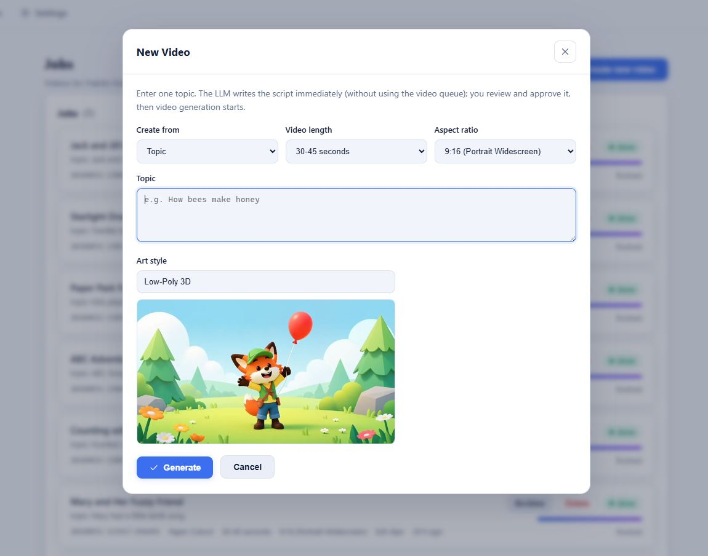
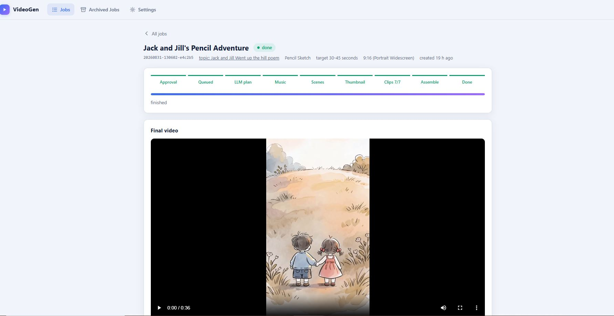
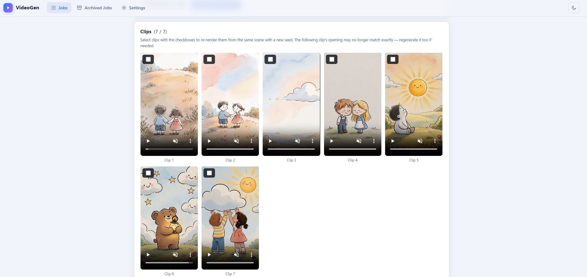
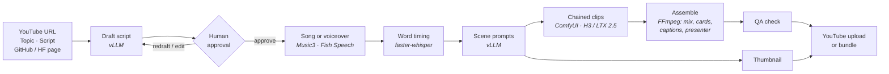

<div align="center">


# VideoGen

**A self-hosted AI video studio for YouTube, Shorts and Reels.**

Give it a YouTube link, a topic, your own script or a GitHub / Hugging Face page. You get back a finished video with a script you approved, an original song or a cloned voiceover, visuals synced to the audio, captions, a thumbnail and SEO metadata. Publishing to YouTube takes one click.

[](https://www.python.org/)
[](https://fastapi.tiangolo.com/)
[](https://github.com/comfyanonymous/ComfyUI)
[](https://github.com/vllm-project/vllm)
[](https://github.com/fishaudio/fish-speech)
[](https://ffmpeg.org/)
[](docs/DOCKER.md)
[](tests)

[](https://github.com/mkamranr/youtube-video-generator/stargazers)
[](https://github.com/mkamranr/youtube-video-generator/commits/main)
[](https://github.com/mkamranr/youtube-video-generator/pulse)
[](https://github.com/mkamranr/youtube-video-generator)
[](https://github.com/mkamranr/youtube-video-generator)

[Features](#-features) · [How it works](#-how-it-works) · [Quick start](#-quick-start) · [Usage](#-usage) · [Configuration](#-configuration) · [Docs](#-documentation)

</div>

---

## ✨ Why VideoGen

- **End to end.** Script, voice, music, clips, thumbnail, captions, SEO and upload all happen in one pipeline, with no hand-offs between tools.
- **Self-hosted.** Every model runs on your own GPU box (ComfyUI, vLLM, Fish Speech). No per-video API bill, and nothing leaves your network except the upload.
- **Built around channels.** Each channel has its own audience rules, branding, cast, voice and defaults, and every video matches its channel.
- **A person approves every script.** No GPU time is spent until someone has read and approved the script. Reels also have a review step on the finished video before they can be published.

## 🚀 Features

### Create from anything

| Source | What happens |
|---|---|
| **YouTube URL** | The captions are fetched and quality-checked, and a new script is drafted from them. You can **edit the transcript** on the approval screen and redraft from your version. |
| **Topic** | The LLM writes an original script about it. |
| **Description / short script** | The LLM expands your outline and stays faithful to it. |
| **Transcript / script** | Your text is used as the narration. The LLM only fixes typos, cue tags and speaker labels. |
| **GitHub / Hugging Face URL** | On Tech channels: an explainer built from the project's README and real facts (stars, downloads, sizes), with a scrolling screenshot of the page and a setup guide for the viewer. |

### Writing and review

- **Script approval for every source.** Drafts are written outside the render queue. You can edit the title and script, ask for a new draft with feedback, or approve it to start rendering.
- **LLM review pass.** Every script and scene prompt is checked a second time against the audio it must match, and mismatches are fixed automatically.
- **Audience-aware safety.** Kids, Family and General presets control the content rules for every prompt.
- **Story videos.** For kids channels, the LLM plans the scenes first and then writes one spoken line per scene, with the characters speaking in their own voices.
- **Weekly planner.** Writes 2–7 dated video ideas for a channel in one go. Each idea becomes a job you can set up and start.

### Sound

- **Generate a song or a voiceover**, chosen per video. Songs come from MiniMax Music 3. Narration is generated by Fish Speech with **voice cloning** from your own reference samples.
- **Bring your own music or lyrics.** Upload a finished track, or paste lyrics to be sung word for word.
- **A clean mix.** Narration sits over an instrumental bed that is ducked under the voice, loudness is normalised to −14 LUFS, and silence is trimmed from the start and end of the narration.

### Visuals

- **Two video models, chosen per video:** MiniMax H3 or LTX 2.5. Each clip starts from the last frame of the one before it, so the motion carries across cuts.
- **Lyric-accurate scenes.** Word timestamps from faster-whisper make each clip show what is being sung or said at that moment.
- **30 art styles**, each with a preview image rendered by your own model.
- **Recurring cast.** Up to 24 named characters per channel with fixed looks, or import a Character Bible. Portraits are approved before use, and characters can be ranked by how well their videos perform.
- **A talking presenter.** A channel portrait is lip-synced to the narration (Wan 2.2 S2V or LTX 2.5) and placed in a corner of the video, either for the whole video or in segments.
- **DIY build shorts.** A fast vertical format where one builder makes a project from raw materials to the finished reveal.

### Packaging

- **On-screen story board.** Fact cards in eight layouts (big stat, comparison, steps, quote and more) are timed to the narration.
- **Burned-in captions** that highlight each word as it is spoken, plus a hook card, an end card and a progress bar.
- **Reel format.** Scored hook options, a scene-by-scene plan with one call to action, layouts that keep text inside the safe area for Reels and Shorts, captions written for each platform, and a step where a person approves the finished video before it is published.
- **Thumbnails that carry text.** An LLM designs the scene and the video model renders it. The channel logo is added, and a short headline is drawn over it in three styles. Videos with a presenter get a second thumbnail that includes them.
- **SEO that ships.** Keyword-optimised titles and descriptions, real tags, the right category and auto-generated chapters.
- **The video keeps its promises.** If the script offers the viewer a checklist or guide, that resource is written and attached to the video.

### Publishing and operations

- **One-click YouTube upload** to each channel's own account (OAuth, uploads private by default), plus a downloadable publish bundle.
- **Compilations** that join 2–12 finished videos into one long upload with chapters, a title and a thumbnail.
- **Upscaling** to 1080p, 2K or 4K, either during assembly or later on demand.
- **Revisions.** Edit any scene prompt, regenerate just the clips you choose (they jump the queue), then reassemble.
- **Reliable.** Jobs resume after a crash (every step can be safely re-run), can be cancelled immediately, share a two-lane queue on one GPU, and can be limited to an overnight GPU window. Every finished video gets a QA check.
- **Multi-user.** Sign-in, an admin account, and channels and videos kept separate per user. Works in dark and light themes.

## 📸 Screenshots

<table>
  <tr>
    <td align="center"><b>New video</b><br></td>
    <td align="center"><b>Finished job</b><br></td>
  </tr>
  <tr>
    <td colspan="2" align="center"><b>Clip grid with targeted regeneration</b><br></td>
  </tr>
</table>

## 🧠 How it works



| Service | Role | Default |
|---|---|---|
| **ComfyUI** | Video clips (MiniMax H3, LTX 2.5), music (MiniMax Music 3), thumbnails, presenter (Wan 2.2 S2V) | `http://<gpu-host>:8188` |
| **vLLM** (OpenAI-compatible) | Scripts, scenes, lyrics, SEO, thumbnails, review | `http://<gpu-host>:8000/v1` |
| **Fish Speech** | Narration and voice cloning | `http://<gpu-host>:7860` |
| **faster-whisper** (CPU) | Word-level timestamps | in-process |
| **u2net / onnxruntime** (CPU) | Presenter cut-out | in-process |
| **FFmpeg** (bundled via `static-ffmpeg`) | Mixing, overlays, assembly, upscaling | local |

## ⚡ Quick start

**Requirements:** Windows or Linux, Python 3.10+, and network access to a GPU host running ComfyUI, vLLM and Fish Speech.

```bash
git clone https://github.com/mkamranr/youtube-video-generator.git
cd youtube-video-generator
pip install -r requirements.txt

# Windows, with an auto-restart watchdog
start_server.bat

# or on any platform
python -m uvicorn app:app --host 127.0.0.1 --port 8080
```

Open **http://localhost:8080**. On the first visit you create the admin account. After that:

1. **Settings → Services**: point the app at your ComfyUI, vLLM and Fish Speech endpoints. The health panel shows the latency of each one.
2. **Settings → Channels**: create a channel (audience, video type, defaults, logo) and optionally connect it to YouTube.
3. **Create new video**.

The ComfyUI workflows ship in [`workflows/`](workflows). Their model weights must be installed on the GPU host. See [docs/DEPLOYMENT.md](docs/DEPLOYMENT.md) for the full list, including air-gapped staging.

> **Docker:** `docker compose up -d`. Volumes and every `VIDEOGEN_*` variable are described in [docs/DOCKER.md](docs/DOCKER.md).

## 🎬 Usage

1. **Create.** Pick a channel and a source, then choose the length, aspect ratio, art style, video model, and song or voiceover.
2. **Review.** The job stops at *Script approval*. Edit the title or script (for a YouTube source you can also edit the transcript), request a new draft, or **Approve & generate video**.
3. **Watch.** The job page shows the pipeline stages live, clip previews as they render, the audio, scene prompts and the log.
4. **Revise.** Edit any scene prompt, regenerate the clips you select, then reassemble.
5. **Publish.** Upload to YouTube with one click, or download the bundle with the video, thumbnail, audio and SEO text.

Finished videos can be archived, resumed after a failure, upscaled, or joined into a **compilation** from the Jobs page.

## ⚙️ Configuration

Every setting can be changed at runtime on the **Settings** page and is saved to `settings.json`. Defaults are in [`config.py`](config.py). The most important ones:

| Setting | Default | Purpose |
|---|---|---|
| `COMFY_URL` / `VLLM_URL` / `FISH_URL` | GPU host | Service endpoints |
| `DEFAULT_VIDEO_MODEL` | `MiniMax H3` | Clip renderer (`MiniMax H3` or `LTX 2.5`) |
| `CLIP_SECONDS` | `5` | Length of each generated clip |
| `DEFAULT_RESOLUTION` | Native | Final upscale target (1080p / 2K / 4K) |
| `SCRIPT_REVIEW` | on | Second LLM pass over scripts and scenes |
| `NARRATION_TRIM_SILENCE` | on | Trim silence from the start and end of the narration |
| `LOUDNESS_LUFS` | `-14` | Loudness target for the final mix |
| `MIN_TRANSCRIPT_WORDS` | `50` | Reject YouTube sources without real speech |
| `GPU_SCHEDULE_ENABLED` | off | Only render inside a daily GPU window |

## 📚 Documentation

| Doc | Covers |
|---|---|
| [ARCHITECTURE.md](docs/ARCHITECTURE.md) | Module map and pipeline internals |
| [API.md](docs/API.md) | HTTP API, including sign-in for scripts |
| [DEPLOYMENT.md](docs/DEPLOYMENT.md) | Windows, Linux and Docker deployment; HTTPS; backups |
| [DOCKER.md](docs/DOCKER.md) | Container image, volumes, environment variables |
| [YOUTUBE.md](docs/YOUTUBE.md) | Connecting channels for one-click upload |
| [REEL_FORMAT.md](docs/REEL_FORMAT.md) | The vertical Reel / Shorts format |

## 🧪 Tests

```bash
python -m unittest discover -s tests -t .
```

The suite is pure unit tests. ComfyUI, vLLM and Fish Speech are mocked, so it runs on any machine.

## 📁 Project layout

```
app.py              FastAPI app: pages, API, auth
pipeline.py         Job model, queue and the end-to-end pipeline
config.py           Defaults and runtime-editable settings
services/           LLM, TTS, ComfyUI, captions, cards, cast, reel, YouTube, …
workflows/          ComfyUI graphs (video, music, presenter)
static/             Web UI
tests/              Unit tests
docs/               Detailed documentation
```

<div align="center">
<sub>Built with FastAPI, ComfyUI, vLLM, Fish Speech and FFmpeg.</sub>
</div>
